# Week 3: Password Cracking with John the Ripper & Networkwalks Tools

**Cybersecurity & Ethical Hacking Project | Networkwalks**

## 📌 Overview

During Week 3 of the Cybersecurity & Ethical Hacking Project, I performed hands-on password-cracking exercises using two different approaches:

1. **John the Ripper (JTR) with Johnny GUI**
2. **Networkwalks Hash Calculator & Password Cracker**

The purpose of these exercises was to understand how password hashes are extracted from password-protected PDF files and how dictionary attacks can be used to recover weak passwords.

Both practical exercises demonstrated the importance of password strength and secure authentication.

---

## 🎯 Objectives

- Understand password hashing and password cracking.
- Extract password hashes from protected PDF files.
- Configure and use John the Ripper with Johnny GUI.
- Perform dictionary attacks using password-cracking tools.
- Explore browser-based password-cracking tools.
- Compare two different approaches to password recovery.
- Understand the importance of strong and unique passwords.

---

## 🛠️ Tools & Technologies Used

| Tool | Purpose |
|---|---|
| John the Ripper (JTR) | Password hash cracking |
| Johnny GUI | Graphical interface for John the Ripper |
| PDF Hash Extractor | Extracting PDF password hashes |
| Networkwalks Hash Calculator | Generating hashes from locked PDF files |
| Networkwalks Password Cracker | Performing dictionary attacks |
| Notepad | Saving extracted hashes |
| Windows PC | Lab environment |
| Web Browser | Accessing online tools |

---

# Module 1: Password Cracking with John the Ripper

## 1. Introduction

John the Ripper is a popular password-security auditing and password-cracking tool. It supports different password hash formats and can be used to test password strength.

Johnny is the graphical user interface (GUI) for John the Ripper, making it easier to perform password-cracking operations.

## 2. Implementation Steps

### Step 1: Download and Install John the Ripper

- Downloaded John the Ripper from its official website.
- Downloaded and installed Johnny GUI.
- Opened Johnny after installation.

**Official Resources:**

- [John the Ripper](https://www.openwall.com/john/)
- [Johnny GUI](https://openwall.info/wiki/john/johnny)

### Step 2: Configure Johnny

- Opened Johnny GUI.
- Navigated to Settings.
- Browsed to the John the Ripper executable.
- Selected `john.exe` from the `run` directory.

### Step 3: Extract the PDF Hash

- Downloaded the provided password-protected PDF.
- Opened the PDF Hash Extractor.
- Uploaded the protected PDF.
- Extracted and copied its password hash.

**Tool:** [Online PDF Hash Extractor](https://www.onlinehashcrack.com/tools-pdf-hash-extractor.php)

**PDF Hash Extraction and Extracted Hash Result**

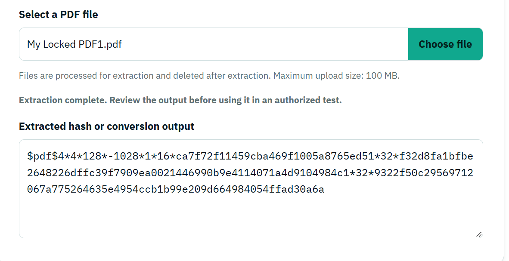

### Step 4: Save the Hash

- Opened Notepad.
- Pasted the extracted hash.
- Saved the file as `hash1.txt`.
- Ensured the hash started with `$pdf$`.

### Step 5: Perform the Password Attack

- Opened Johnny GUI.
- Selected **Open Password File**.
- Loaded `hash1.txt`.
- Clicked **Start New Attack**.
- Waited for the cracking process to complete.

**Opening the Password File**

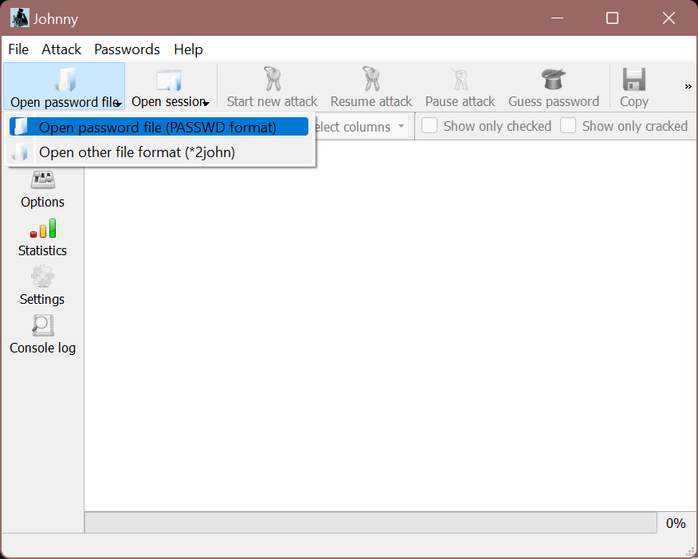

**Password Cracking Process**

### Step 6: Verify the Result

After recovering the password, opened the protected PDF and entered the recovered password to verify successful access.

**Successfully Opened PDF**

## 3. Result

Successfully recovered the password of the provided protected PDF using John the Ripper through Johnny GUI.

---
**PDF2 Hash Extraction and Extracted Hash Result**
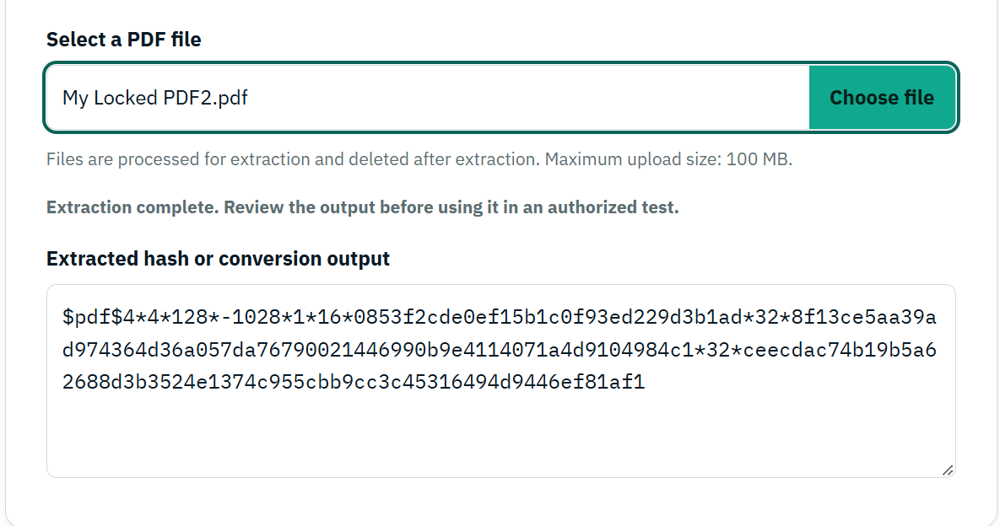

**Opening the Password File**

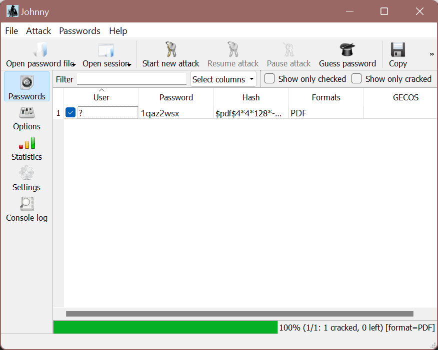

**Successfully Opened PDF**

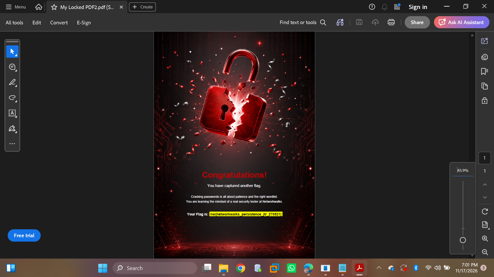

**PDF3 Hash Extraction and Extracted Hash Result**
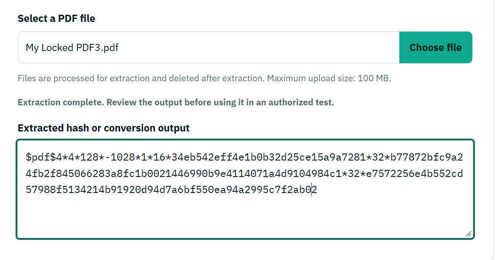

**Opening the Password File**

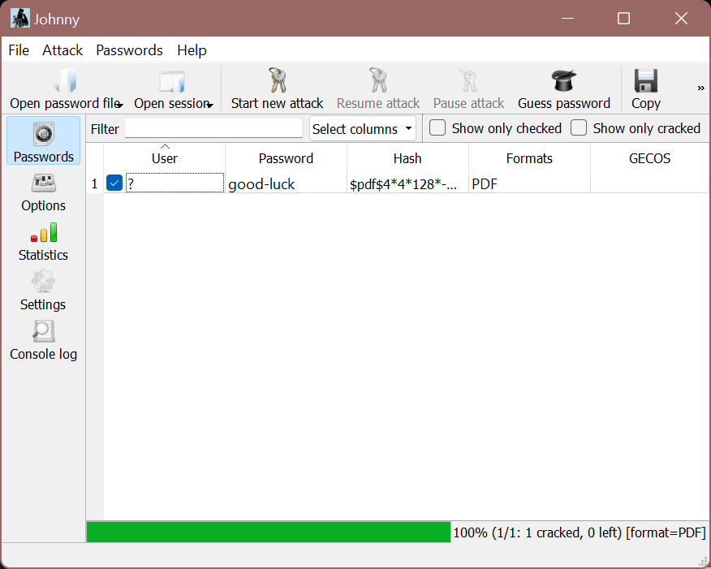

**Successfully Opened PDF**

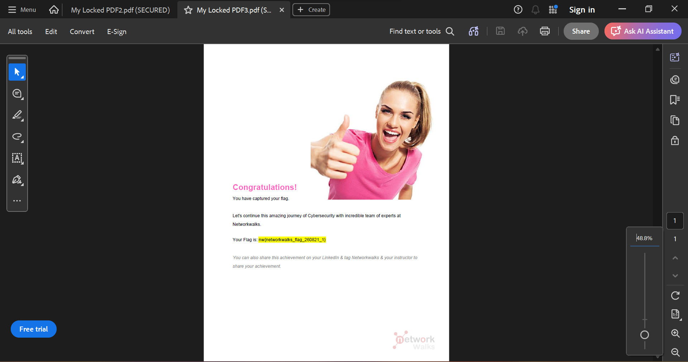

# Module 2: Password Cracking with Networkwalks Tools

## 1. Introduction

In this module, I used two browser-based tools provided by Networkwalks:

- **Hash Calculator:** Extracts the password hash from a protected PDF.
- **Password Cracker:** Attempts to recover the original password by testing password candidates from a wordlist.

Unlike the previous module, this approach did not require installing John the Ripper or Johnny.

## 2. Implementation Steps

### Step 1: Download the Protected PDF

Downloaded the provided password-protected PDF file from the Networkwalks project task page.

[Networkwalks Project Task – Password Cracking](https://networkwalks.com/project-task-lab-password-cracking-with-networkwalks-tools/)

### Step 2: Open Hash Calculator

Opened the Networkwalks Hash Calculator in a web browser.

[Networkwalks Hash Calculator](https://networkwalks.com/hash-calculator/)

**Hash Calculator**

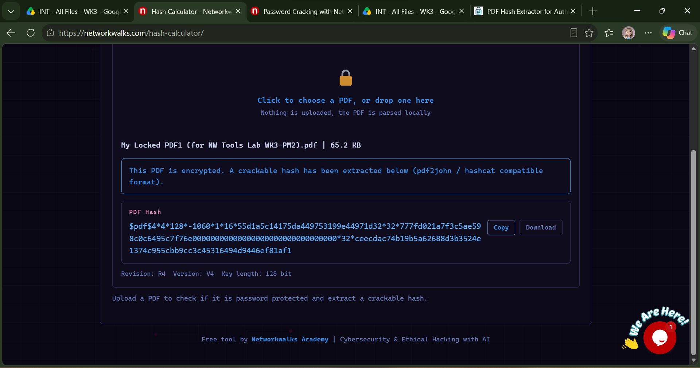

### Step 3: Extract the PDF Hash

- Uploaded the locked PDF file.
- Allowed the tool to process the file.
- Obtained the extracted hash beginning with `$pdf$`.
- Copied the complete hash value.

**Uploading the PDF**

### Step 4: Open Password Cracker

Opened the Networkwalks Password Cracker.

[Networkwalks Password Cracker](https://networkwalks.com/password-cracker/)

### Step 5: Perform Dictionary Attack

- Pasted the extracted hash into the Password Cracker.
- Started the attack.
- The tool tested different passwords from its wordlist.
- Waited for the matching password to be identified.

**Password Cracking Result**

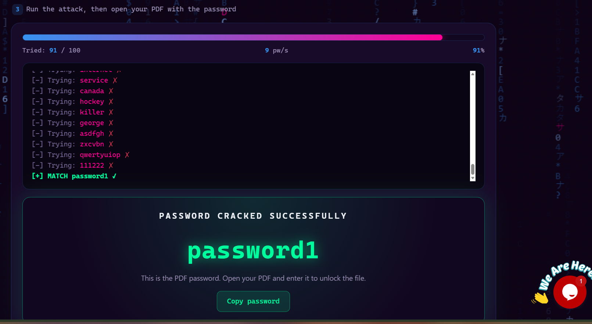

### Step 6: Verify the Recovered Password

- Obtained the recovered password.
- Opened the protected PDF.
- Entered the recovered password.
- Successfully accessed the PDF document.

**Entering the PDF Password**

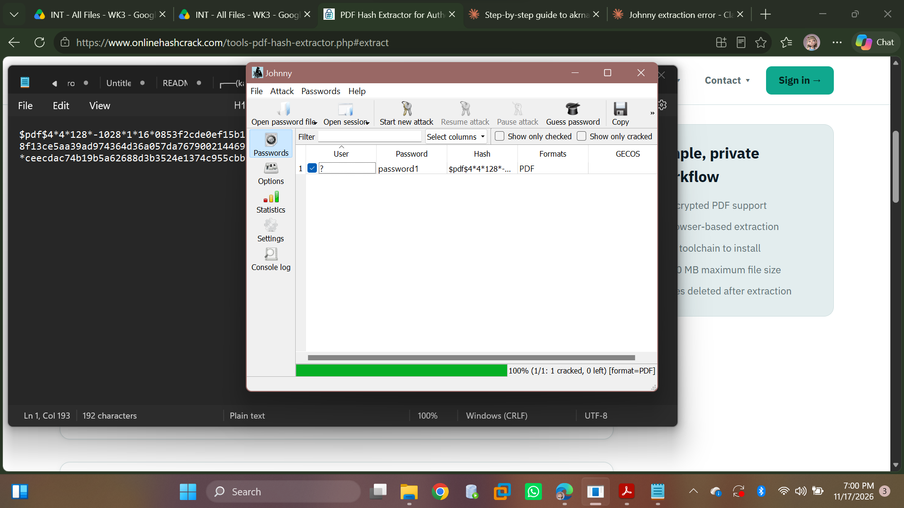

**Successfully Accessed PDF**

## 3. Result

Successfully recovered the password using Networkwalks Hash Calculator and Password Cracker without installing additional cracking software.

---

# 📊 Overall Results

During the Week 3 practical exercises, I worked with four password-protected PDF files and successfully recovered their passwords.

| Module | Tools | Outcome |
|---|---|---|
| Module 1 | John the Ripper + Johnny | Password recovered |
| Module 2 | Networkwalks Hash Calculator + Password Cracker | Password recovered |
| Additional Practice | Both approaches | Two additional passwords recovered |

**Overall Achievement:** Successfully recovered passwords from four password-protected PDF files through hands-on exercises.

---

# 🧠 What I Learned

### 1. Password Hashing
Learned that hashing transforms input data into a fixed-format hash value. It is a one-way process, unlike encryption.

### 2. Hash Extraction
Understood how password hashes can be extracted from password-protected PDF files and prepared for password-cracking tools.

### 3. Dictionary Attacks
Learned how dictionary attacks test words and password candidates until a matching hash is found.

### 4. John the Ripper
Gained practical experience configuring Johnny GUI, loading password hash files, and starting password-cracking attacks.

### 5. Browser-Based Security Tools
Explored how online tools can perform hash extraction and password-cracking operations without local software installation.

### 6. Password Security
Understood why common, short, and reused passwords are vulnerable to dictionary attacks.

---

# 🔐 Security Recommendations

- Use long and complex passwords.
- Avoid common passwords and predictable patterns.
- Never reuse passwords across multiple accounts.
- Use a trusted password manager.
- Enable Multi-Factor Authentication (MFA).
- Regularly review password security.

---

# ⚠️ Disclaimer

This project was performed for educational purposes as part of a Cybersecurity & Ethical Hacking training program.

All password-cracking exercises were conducted using the provided lab files in an authorized learning environment.

Password-cracking techniques should only be used on files and systems for which proper authorization has been obtained.

---

# 🚀 Conclusion

Week 3 provided practical exposure to password hashing, hash extraction, and dictionary-based password attacks.

By using John the Ripper with Johnny GUI and Networkwalks browser-based tools, I gained a better understanding of how weak passwords can be recovered and why strong password practices are essential in cybersecurity.

This hands-on experience strengthened my understanding of password security and ethical hacking fundamentals.

---
**Author:** Mustabshra Rehman

**Batch:** B084

**Training Platform:** Networkwalks   

**Topic:** Password Cracking  
**Tools:** John the Ripper, Johnny GUI, Networkwalks Tools

#CyberSecurity #EthicalHacking #JohnTheRipper #PasswordSecurity #Networkwalks #InfoSec #CyberSecurityLearning
